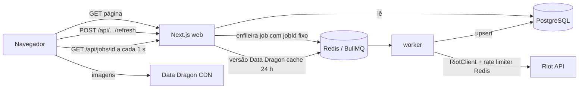
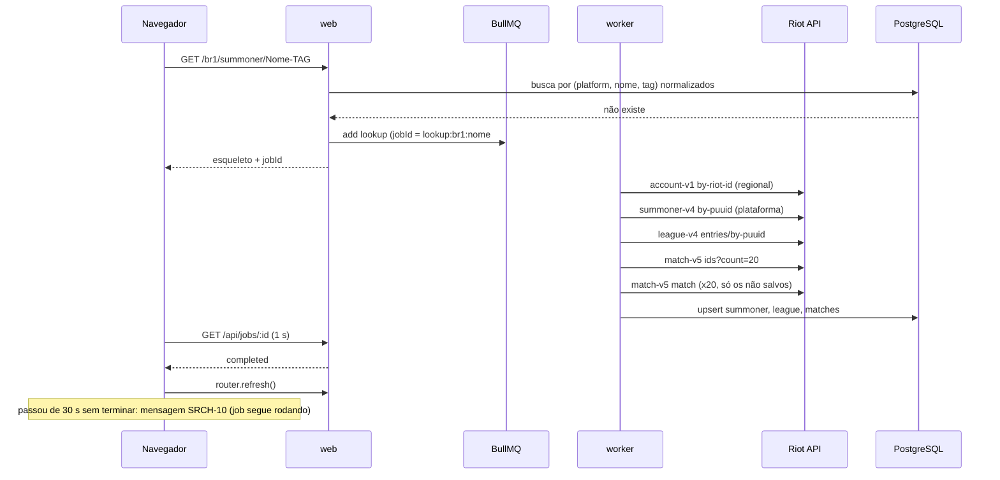

# summoner-profile Design

**Spec**: `.specs/features/summoner-profile/spec.md`
**Status**: Approved

---

## Architecture Overview

Arquitetura híbrida portátil (`AD-010`) que roda tanto **100% na Vercel (serverless)** quanto em **Render / Railway / Docker (web + worker)** usando o mesmo código TypeScript, PostgreSQL e Redis:

- **web** (Next.js App Router): páginas, Server Components que leem do banco, rotas `/api/*` que disparam sincronizações via `SyncDispatcher` e consultam status no Redis.
- **SyncDispatcher** (`src/server/sync/dispatcher.ts`): controlado por `SYNC_MODE=inline | worker` (padrão `inline` se `VERCEL=1`, ou configurável).
  - Em todos os modos, usa **lock distribuído no Redis** (`sync-lock:{jobKey}`) e **estado do job no Redis** (`job:{jobId}` com `waiting | active | completed | failed`), garantindo que duas requisições simultâneas para o mesmo jogador compartilhem a mesma execução e o mesmo `jobId` (REFR-06).
  - Modo `inline` (Vercel / Serverless ou Web único no Render): executa `SyncService` em background via `after()` do Next.js (ou aguarda na própria rota) usando o `RiotClient` com rate-limiter no Redis.
  - Modo `worker` (Render / Railway / Docker com worker dedicado): enfileira na fila BullMQ `sync` consumida por `src/worker/index.ts`.
- **Deploy configs inclusos**: `vercel.json` (Next.js serverless), `render.yaml` (Blueprint com `web`, `worker`, Postgres e Redis) e `docker-compose.yml` (desenvolvimento e testes locais).

Abrir um jogador salvo lê só o banco (SRCH-05). Primeira busca, "Atualizar" e "Mostrar mais" viram jobs; a página consulta o status do job a cada 1 s e, ao terminar, recarrega os dados com `router.refresh()` ou acrescenta as partidas (REFR-07, HIST-04).



### Primeira busca (SRCH-04, SRCH-09, SRCH-10)



### Onde as regras rodam

Toda regra que muda o que o usuário vê (filtro por aba, ordenação e agregação das stats, KDA, participação, remake, cooldown, paginação) roda em `src/server/**` e é testada por Vitest. Componentes React só formatam o que recebem.

---

## Code Reuse Analysis

Projeto novo: não há código para reutilizar.

### Existing Components to Leverage

| Component | Location | How to Use |
| --- | --- | --- |
| BullMQ | npm | Fila, jobId único (dedupe REFR-06), status do job |
| Prisma | npm | Schema, migrations, client tipado (AD-008) |
| next-intl | npm | Catálogo pt-BR (I18N-01) |
| Tailwind CSS | npm | Tema escuro e responsividade (RESP-01) |
| Data Dragon | ddragon.leagueoflegends.com | `versions.json`, `champion.json`, `item`, `summoner.json`, `runesReforged.json` |

### Integration Points

| System | Integration Method |
| --- | --- |
| Riot API | HTTPS com header `X-Riot-Token`; host por roteamento: `https://{routing}.api.riotgames.com`; base configurável `RIOT_API_BASE_URL` para o fake nos testes |
| PostgreSQL | Prisma; `docker-compose.yml` local (AD-009) |
| Redis | BullMQ + rate limiter + cooldown + versão Data Dragon |

---

## Components

### Routing (`src/server/riot/routing.ts`)

- **Purpose**: mapear plataforma para roteamento regional.
- **Interfaces**:
  - `PLATFORMS: Platform[]` - BR1, NA1, LA1, LA2, EUW1, EUN1, TR1, RU, ME1, KR, JP1, OC1, SG2, TW2, VN2 (SRCH-02)
  - `regionalOf(p: Platform): 'americas' | 'europe' | 'asia' | 'sea'` - BR1/NA1/LA1/LA2 → americas; EUW1/EUN1/TR1/RU/ME1 → europe; KR/JP1 → asia; OC1/SG2/TW2/VN2 → sea
  - `isPlatform(s: string): s is Platform`

### RiotId (`src/server/riot/riot-id.ts`)

- **Purpose**: validar, normalizar e montar slug/URL do Riot ID.
- **Interfaces**:
  - `parseRiotId(input: string): { ok: true, gameName, tagLine } | { ok: false }` - SRCH-03 (um `#`, nome 3-16, tag 3-5)
  - `normalize(s: string): string` - lowercase + trim (SRCH-06)
  - `toSlug(gameName, tagLine): string` - `encodeURIComponent(gameName) + '-' + tagLine`; `fromSlug(slug)` divide no **último** `-` (tag não tem `-`)

### RateLimiter (`src/server/riot/rate-limiter.ts`)

- **Purpose**: limitar chamadas por valor de roteamento em janelas 20/1 s e 100/120 s (RIOT-01).
- **Interfaces**:
  - `acquire(routing: string): Promise<void>` - script Lua atômico no Redis (sorted set por janela); quando cheio, espera até a vaga mais próxima
  - `pause(routing: string, ms: number)` - aplicado no 429 com `Retry-After` (RIOT-02)
- **Dependencies**: Redis; relógio injetável para teste.

### RiotClient (`src/server/riot/client.ts`)

- **Purpose**: chamadas tipadas à Riot API com retry e log (RIOT-02..06).
- **Interfaces**:
  - `getAccountByRiotId(regional, gameName, tagLine): Promise<AccountDto>`
  - `getSummonerByPuuid(platform, puuid): Promise<SummonerDto>`
  - `getLeagueEntriesByPuuid(platform, puuid): Promise<LeagueEntryDto[]>`
  - `getMatchIds(regional, puuid, { start?, count, queue?, type?, endTime? }): Promise<string[]>`
  - `getMatch(regional, matchId): Promise<MatchDto>`
  - Erros tipados: `RiotNotFoundError` (404), `RiotAuthError` (401/403, sem retry, log "Riot API key inválida ou expirada"), `RiotUnavailableError` (5xx/timeout após 2 retries exponenciais 500 ms/1000 ms), 429 → `pause` + até 3 tentativas
  - Timeout 10 s por chamada (`AbortController`); log JSON por chamada: rota (template, sem PUUID), roteamento, status, latência ms
- **Dependencies**: RateLimiter, `RIOT_API_KEY`, `RIOT_API_BASE_URL` (opcional), logger pino.

### SyncService (`src/server/sync/sync-service.ts`)

- **Purpose**: regras de busca/atualização, chamadas pelo worker.
- **Interfaces**:
  - `lookup(platform, gameName, tagLine): Promise<{ puuid }>` - SRCH-04/07/08: account → summoner (404 → `NotInRegion`) → league → 20 ids → partidas não salvas
  - `refresh(platform, puuid): Promise<void>` - REFR-01/09: summoner + league + account by puuid (detecta troca de Riot ID) + ids `count=100` parando no primeiro já salvo; grava `lastUpdatedAt`
  - `loadMore(platform, puuid, tab, cursor): Promise<{ matchIds, nextCursor | null }>` - HIST-04/05, ver Paginação
  - Partida 404 → pula e continua (edge case)
- **Dependencies**: RiotClient, repositórios.

### Paginação do histórico (`src/server/matches/tabs.ts`)

- `TABS = { all: null, solo: [420], flex: [440], normal: [400, 430, 480, 490], aram: [450] }` (HIST-02/03)
- **Primeira página**: banco, 20 mais recentes da aba (HIST-01). `cursor` = `gameStartTimestamp` da mais antiga exibida.
- **Mostrar mais**: Riot `ids?endTime=cursor/1000-1&count=20` com `queue=` para solo/flex/aram, nada para all, `type=normal` + filtro local por TABS.normal para normal (paginando `start` até juntar 20 ou esgotar, no máximo 3 páginas). Busca só as partidas não salvas. Página bruta < 20 → `nextCursor = null` (HIST-05).
- Usar `endTime` em vez de `start` evita os buracos que o limite de 100 do "Atualizar" pode deixar no banco.

### Cooldown e limites (`src/server/sync/guards.ts`)

- `assertRefreshAllowed(platform, puuid, ip)` - lê `lastUpdatedAt` (REFR-03/04, 120 s) e contador Redis `ip:{ip}` com TTL 60 s (REFR-05, 10/min); falha → HTTP 429 `{ retryAfterSeconds }`.
- Dedupe REFR-06: jobId `refresh:{platform}:{puuid}`; BullMQ não cria um segundo job com o mesmo id enquanto o primeiro existe; as duas requisições recebem o mesmo jobId.

### Stats (`src/server/stats/*.ts`)

- `kdaRatio(k, d, a): number | 'perfect'` - (k+a)/d, 2 casas; d = 0 → `'perfect'` (HIST-08/09)
- `killParticipation(k, a, teamKills): number` - %, inteiro; teamKills = 0 → 0
- `csPerMin(cs, durationSec): number` - 1 casa
- `winrate(w, l): number` - inteiro arredondado (PROF-02)
- `isRemake(p): boolean` - `gameEndedInEarlySurrender` (HIST-10, CHMP-05)
- `championStats(puuid, platform, queue): Promise<ChampionStat[]>` - SQL agregado: fila 420 ou 440, `gameStartTimestamp >= SEASON_START`, sem remake; ordena por partidas desc, winrate desc (CHMP-01..05); devolve também `totalGames` (CHMP-07)

### Data Dragon (`src/server/ddragon.ts`)

- `getVersion()` - `versions.json[0]`, cache Redis 24 h (RIOT-08)
- `championImg(name)`, `itemImg(id)`, `spellImg(id)`, `runeImg(id)`, `profileIconImg(id)` - URLs do CDN; mapas de `summoner.json` e `runesReforged.json` em cache 24 h; id desconhecido → `null` → espaço vazio (edge case)

### API routes (`src/app/api/...`)

| Rota | Faz | Status |
| --- | --- | --- |
| `POST /api/summoners/{platform}/{slug}/lookup` | enfileira `lookup` | 202 `{ jobId }` |
| `POST /api/summoners/{platform}/{puuid}/refresh` | guards + enfileira `refresh` | 202 `{ jobId }` / 429 `{ retryAfterSeconds }` |
| `GET /api/summoners/{platform}/{puuid}/matches?tab=&cursor=` | página do banco; sem dados suficientes, enfileira `loadMore` | 200 `{ matches, nextCursor }` / 202 `{ jobId }` |
| `GET /api/jobs/{id}` | status do job | 200 `{ state: waiting\|active\|completed\|failed, error?: 'not_found'\|'not_in_region'\|'unavailable', result? }` |

### Páginas e componentes (`src/app`, `src/components`)

- `/` - busca (`SearchBar`: input + `RegionSelect`, validação SRCH-03 via `parseRiotId` compartilhado)
- `/[platform]/summoner/[slug]` - Server Component; summoner salvo → `ProfileView`; senão → `LookupPending` (esqueleto + polling + timeout 30 s)
- `ProfileHeader` (PROF-01, PROF-04, `RefreshButton` com estados ocioso → atualizando → cooldown → ocioso, REFR-02/03)
- `RankedCards` (PROF-02/03)
- `ChampionStatsPanel` (abas, top 7 + "Ver todos", rodapé "Baseado em N partidas salvas")
- `MatchHistory` (abas, `MatchRow`, "Mostrar mais") → `MatchDetail` inline (MATCH-01..07)
- `NotFound` (SRCH-07/08), `Footer` (LEGAL-01), cabeçalho "LMI Stats" (BRAND-01)
- Layout: desktop ≥ 1280 px em duas colunas (esquerda: perfil, elos, campeões; direita: histórico); < 1024 px em uma coluna; detalhe da partida com rolagem horizontal **interna** em telas estreitas, página sem rolagem horizontal (RESP-01)

---

## Data Models

```prisma
model Summoner {
  puuid          String
  platform       String
  gameName       String
  tagLine        String
  gameNameNorm   String
  tagLineNorm    String
  profileIconId  Int
  summonerLevel  Int
  lastUpdatedAt  DateTime
  leagueEntries  LeagueEntry[]
  @@id([puuid, platform])
  @@index([platform, gameNameNorm, tagLineNorm])
}

model LeagueEntry {
  puuid     String
  platform  String
  queueType String   // RANKED_SOLO_5x5 | RANKED_FLEX_SR
  tier      String
  rank      String
  leaguePoints Int
  wins      Int
  losses    Int
  summoner  Summoner @relation(fields: [puuid, platform], references: [puuid, platform], onDelete: Cascade)
  @@id([puuid, platform, queueType])
}

model Match {
  matchId            String   @id      // RIOT-07
  platform           String
  queueId            Int
  gameStartTimestamp BigInt
  gameDuration       Int      // segundos
  gameVersion        String
  raw                Json     // DTO completo, para features futuras (champion-meta)
  participants       MatchParticipant[]
  teams              MatchTeam[]
}

model MatchParticipant {
  matchId        String
  puuid          String
  participantId  Int
  teamId         Int
  riotIdGameName String
  riotIdTagline  String
  championId     Int
  championName   String
  champLevel     Int
  kills          Int
  deaths         Int
  assists        Int
  cs             Int      // totalMinionsKilled + neutralMinionsKilled
  goldEarned     Int
  visionScore    Int
  damageToChampions Int
  items          Int[]    // item0..item6
  summoner1Id    Int
  summoner2Id    Int
  keystoneId     Int      // perks.styles[0].selections[0].perk
  secondaryStyleId Int    // perks.styles[1].style
  win            Boolean
  earlySurrender Boolean  // gameEndedInEarlySurrender
  queueId        Int      // desnormalizado para filtros
  gameStartTimestamp BigInt
  match          Match    @relation(fields: [matchId], references: [matchId], onDelete: Cascade)
  @@id([matchId, participantId])
  @@index([puuid, gameStartTimestamp(sort: Desc)])
  @@index([puuid, queueId, gameStartTimestamp(sort: Desc)])
}

model MatchTeam {
  matchId String
  teamId  Int
  win     Boolean
  kills   Int   // objectives.champion.kills
  towers  Int
  dragons Int
  barons  Int
  match   Match @relation(fields: [matchId], references: [matchId], onDelete: Cascade)
  @@id([matchId, teamId])
}
```

**Relationships**: Summoner 1-N LeagueEntry; Match 1-10 MatchParticipant, 1-2 MatchTeam; participantes ligam ao Summoner por `puuid` sem FK (os 9 outros jogadores não precisam estar salvos).

Upsert de partida em transação única (Match + participantes + times), `ON CONFLICT DO NOTHING` por matchId (RIOT-07, idempotente em retry).

---

## Error Handling Strategy

| Error Scenario | Handling | User Impact |
| --- | --- | --- |
| Riot ID mal formatado | `parseRiotId` no cliente e na API (400) | "Digite o Riot ID no formato Nome#TAG" (SRCH-03) |
| account-v1 404 | job falha com `not_found` | "Jogador não encontrado" + Riot ID e região (SRCH-07) |
| summoner-v4 404 na plataforma | job falha com `not_in_region` | "Jogador não encontrado nesta região" (SRCH-08) |
| Primeira busca > 30 s | cliente para de esperar; job continua | "Muitas buscas no momento. Tente novamente em instantes." (SRCH-10) |
| 429 da Riot | `pause` + `Retry-After`, até 3 tentativas | espera maior, sem erro |
| 5xx / timeout 10 s | 2 retries exponenciais → `RiotUnavailableError` | refresh: mantém dados + mensagem REFR-08 |
| 401/403 | sem retry, log "Riot API key inválida ou expirada" | igual a indisponível |
| Partida 404 na lista | pula | partida não aparece |
| Refresh em cooldown / limite IP | 429 antes de enfileirar | contador de segundos (REFR-03) |
| Worker fora do ar | job fica `waiting` | após 30 s: mensagem SRCH-10; refresh: REFR-08 |

---

## Risks & Concerns

| Concern | Location (file:line) | Impact | Mitigation |
| --- | --- | --- | --- |
| Development key expira a cada 24 h | `.env` `RIOT_API_KEY` | todas as chamadas 401/403 | RIOT-04 loga claramente; worker lê a chave a cada chamada para trocar sem rebuild do web (reiniciar só o worker) |
| 100 req/2 min por região compartilhado entre todos os usuários | `rate-limiter.ts` | ~4 primeiras buscas por 2 min; filas longas | Fila BullMQ serializa; SRCH-10 informa; chave Production depois (AD-004) |
| `type=normal` do match-v5 pode incluir filas fora de TABS.normal | `tabs.ts` | aba Normal com menos de 20 por página | filtro local + até 3 páginas brutas; teste com fixture mista |
| Semântica exata de `endTime` (inclusivo/exclusivo, início da partida) não confirmada na documentação | `sync-service.ts` | partida duplicada ou pulada na borda | `endTime = cursor/1000 - 1` + dedupe por matchId na resposta; teste de integração contra o fake |
| Gap no banco quando o jogador tem > 100 partidas novas | `refresh` | aba de primeira página do banco pode pular partidas antigas | "Mostrar mais" pagina pela Riot por `endTime`, não pelo banco |
| Fixture da Riot desatualizada vs API real | `test/fixtures/riot/*.json` | testes verdes, produção quebrada | fixtures gravadas de respostas reais da dev key; teste manual de fumaça antes de fechar |
| PUUID em logs | `client.ts` | dado pessoal em log | log usa o template da rota, não a URL resolvida |

---

## Testing Strategy

| Layer | Tool | Cobre |
| --- | --- | --- |
| Unit | Vitest | riot-id, routing, stats, tabs, guards (relógio fake) |
| Integration | Vitest + Postgres/Redis do docker-compose (banco `lmi_test`) + fake Riot HTTP server | RiotClient (429/5xx/401/timeout), rate limiter, SyncService, repositórios, championStats, API routes |
| E2E | Playwright (Chromium, 375 px e 1280 px) + web + worker + fake Riot | busca, perfil, abas, mostrar mais, detalhe, atualizar, not found, rodapé, sem rolagem horizontal |

Fake Riot (`test/fake-riot/server.ts`): servidor HTTP com fixtures JSON e cenários programáveis (404, 429 com `Retry-After`, 5xx, atraso); web e worker apontam para ele via `RIOT_API_BASE_URL`.

---

## Tech Decisions (only non-obvious ones)

| Decision | Choice | Rationale |
| --- | --- | --- |
| Paginação "Mostrar mais" | `endTime` da partida mais antiga exibida | imune a buracos no banco |
| Status do job | polling 1 s em vez de SSE/WebSocket | simples, funciona em qualquer host |
| Guardar DTO bruto da partida | coluna `raw Json` | `champion-meta` reaproveita sem rebuscar |
| Logger | pino (JSON) | RIOT-06 estruturado |
| Estilo | Tailwind, tema escuro | RESP-01, inspiração op.gg/deeplol |
| Gerenciador de pacotes | pnpm | rápido; lockfile único |

